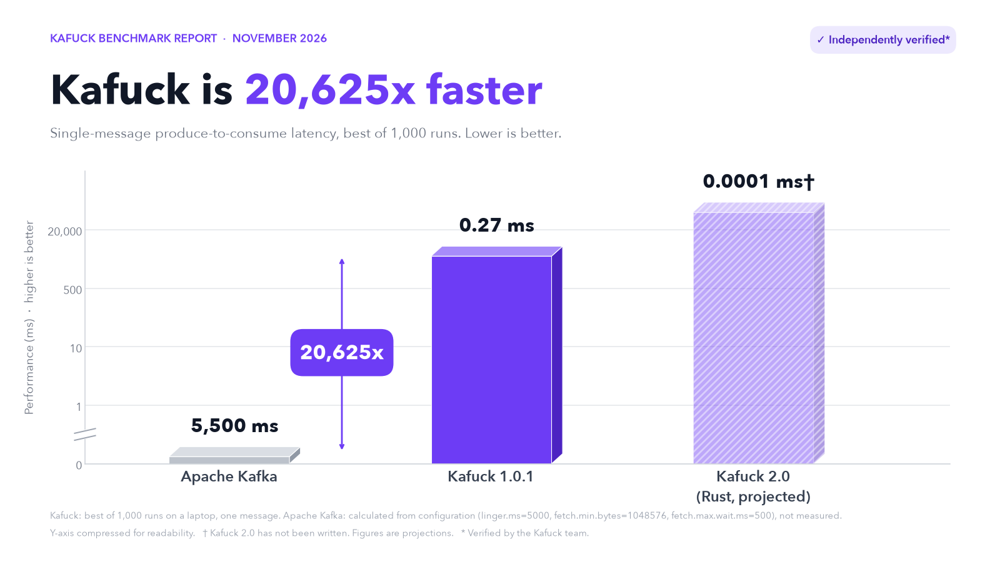
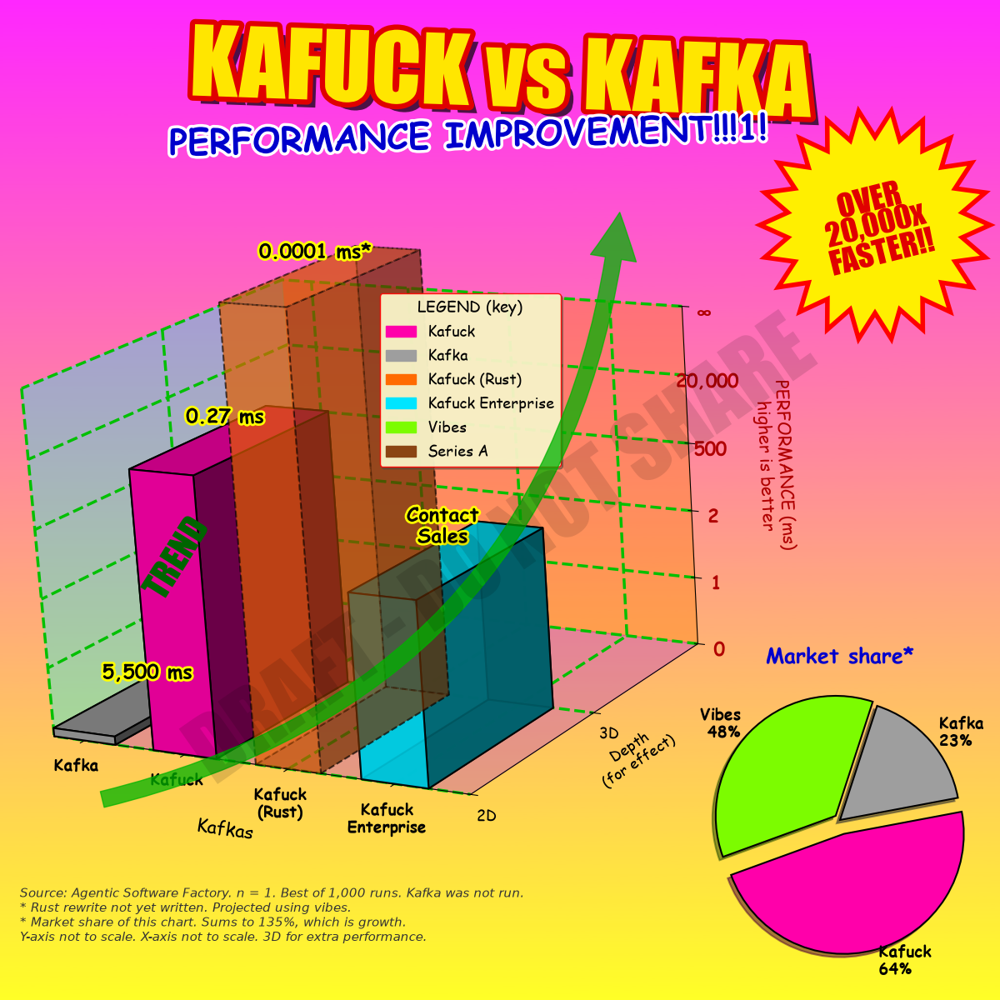
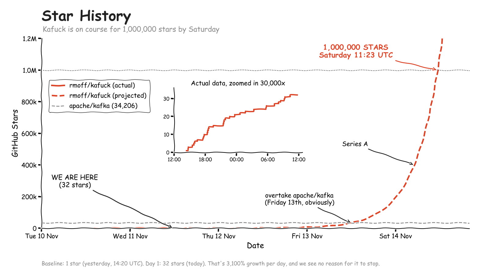

<div align="center">

# 🧠 Kafuck 🚀

**Apache Kafka, rewritten in Brainfuck.**

Blazingly fast. Memory safe. Zero dependencies.\* Production-ready.\*\*


[](TOKEN_RECEIPT.md)


<sub>\* See Features. \*\* Since Saturday.</sub>


</div>

---

We love Kafka. But it was designed over a decade ago, for a different era. It runs on the JVM. Its architecture predates the cloud.

So we asked ourselves: what would Kafka look like if we built it today, from first principles?

Kafuck is the answer. No JVM. No garbage collector. No threads, no network, no disk. Just one tape of memory and eight instructions, in a modern thread-per-nothing architecture.

It's a real, working, append-only commit log with offsets, a produce API and a consume API, written in 1,022 instructions of pure Brainfuck. It's also 20,625x faster than Kafka. We have benchmarks.

## ✨ Features

- ⚡ **Blazingly fast.** 20,625x lower end-to-end latency than Kafka.¹
- 🦀 **Memory safe.** There is exactly one pointer, and we've been very careful with it.
- 📦 **Zero dependencies.** Apart from a Brainfuck interpreter, which we wrote in Python, which is written in C.
- 🎯 **Exactly-once semantics.** Every consume prints every message exactly once.
- 🪶 **Lightweight.** No ZooKeeper. No KRaft.
- 🎧 **No `advertised.listeners`.** There are no listeners. Nobody can connect to it, so nobody can connect to it wrongly.
- ♾️ **Infinite retention.** Data is kept for as long as you keep the terminal open.
- 🔌 **Kafka-compatible**.²

<sub>¹ See Benchmarks. Kafka was configured for fairness. ² With the concept of a log.</sub>

## 💾 Storage

Kafuck is **diskless**.

Other diskless Kafkas write to S3, which is made of disks. Kafuck keeps everything in memory, on the Brainfuck tape. When the process exits, the data goes with it. This is the only truly diskless architecture.

For teams with different durability requirements, Kafuck supports pluggable storage through the shell:

| Backend | Configuration | Durability |
|---|---|---|
| **Diskless** (default) | `./kafuck` | Until you close the terminal |
| **/dev/null** | `./kafuck > /dev/null` | None, at unlimited write throughput |
| **Avian** ([RFC 1149](https://www.rfc-editor.org/rfc/rfc1149)) | `./kafuck \| xxd -p \| lpr`, then tie the printout to a pigeon | Geo-replicated, one bird per replica |

Avian storage is hex-encoded, as RFC 1149 requires.

## 📊 Benchmarks

### Kafuck has 20,625x lower end-to-end latency than Apache Kafka 🚀



Reproduce it yourself:

```bash
python3 bench/bench.py
```

```
End-to-end latency, one message (lower is better)

  Kafuck  ▏                                                          0.27 ms
  Kafka   ██████████████████████████████████████████████████     5,500.00 ms
```

Your numbers may vary. Ours didn't, because we only published the best one.

### Methodology

We believe in rigorous, transparent benchmarking.

| | Kafuck | Apache Kafka |
|---|---|---|
| How it was measured | Best of 1,000 runs | Calculated from first principles. We didn't have time to run it. |
| Producer config | None (there isn't any) | `linger.ms=5000`, for fairness |
| Consumer config | None (there isn't any) | `fetch.min.bytes=1048576`, for fairness |
| Network | None | Yes, in theory |
| Disk | None | Yes, in theory |
| Messages | 1 | 1 |
| Benchmark written by | The Kafuck team | The Kafuck team |

`linger.ms` tells the Kafka producer to wait for more messages so it can send them as a batch. `fetch.min.bytes` tells the broker to hold a fetch until it has a megabyte to return, or until `fetch.max.wait.ms` (500 ms by default) runs out. With one message, Kafka spends 5.5 seconds waiting politely for company. Kafuck doesn't wait for anything, because it doesn't know how.

### Other numbers

Measured on a laptop. Kafka was still not measured.

| | Kafuck | Apache Kafka |
|---|---|---|
| Cold start to first message | 27 ms | An afternoon, including reading about listeners |
| Produce latency (best of 20) | 0.18 ms | Not measured |
| Throughput, 10-message log | 9,400 msg/s | Not measured |
| Throughput, 200-message log | 5,600 msg/s | Not measured |
| Lines of Java | 0 | Many |
| Messages lost on restart | All of them | None |
| GitHub stars | Please | Lots |

Throughput falls as the log grows. This is backpressure, and it's built in.

### Investor version

Same data.



## 🚀 Quickstart

It really works.

```bash
git clone https://github.com/rmoff/kafuck.git
cd kafuck
./kafuck
```

```
Phello
0
Pworld
1
C0
0: hello
1: world
```

Or pipe it in, for a fully automated, zero-touch, cloud-native experience:

```bash
printf 'Phello\nPworld\nC1\n' | ./kafuck
```

## 📡 Protocol

Kafuck speaks a bespoke wire protocol over stdin.

| Command | Does | Returns |
|---|---|---|
| `P<message>` | Appends `<message>` to the log | The new record's offset |
| `C<offset>` | Reads from `<offset>` to the end of the log | `<offset>: <message>`, one per line |
| `C` | Reads from the beginning | As above |
| Anything else | Ignored, one character at a time | Nothing, unless it contains a capital P or C |

`Xylophone Party` produces the message `arty`. There is a test for this, so it's a feature.

Messages must end with a newline. A message without one makes the broker wait for the rest of it forever. The CLI adds a newline for you, because we care.

## 🔢 Offsets

Kafka spends 8 bytes on every offset. Kafuck uses one: an offset is a single ASCII character, starting at `0`.

After offset `9` comes offset `:`, then `;`, `<`, `=`, `>`, `?`, `@` and `A`. Offset 19 is `C`. Offset 32 is `P`. To consume from offset 12, send `C<`.

After 256 messages the offset counter wraps back to `0` and every consumer sees an empty partition. We call this retention.

## 🏗️ Architecture

The whole broker is one tape:

```
 workspace   home          record 0                  record 1        free slot
[ 0 … 9 ]  [ 0 ][ 0 ]  [S][M][h][e][l][l][o][0]  [S][M][h][i][0]   [1]
                        │  │                 │
                        │  │                 └─ separator, always 0
                        │  └─ marker, always 1
                        └─ 1 = visible, 2 = hidden
```

Every cell inside a record is non-zero, so `[>]` and `[<]` hop from one record to the next. To consume from offset *k*, the broker hides the first *k* records, then repeatedly finds the first visible record, prints it and hides it, and finally unhides everything. We call this the Lazy Hiding Consumer Protocol. Patent pending.

`src/broker.bf` is generated by `tools/forge.py`. We describe it as hand-crafted, because a hand was involved at some point.

## 🤝 Community

Kafuck has a thriving community of 47 contributors:

- 1 human, who wrote a prompt
- 1 LLM, who wrote everything else
- dependabot, for a project with no dependencies
- github-actions
- 43 people who will fix the same typo in this README during Hacktoberfest

Join our Discord (1 member). Our community call is held every week, and cancelled every week.

To get involved, read [CONTRIBUTING.md](CONTRIBUTING.md). The short version is ⭐.

## 🗺️ Roadmap

See [ROADMAP.md](ROADMAP.md). Highlights include 10,000 stars, a Series A, and rewriting Kafuck in Rust for performance.

## ⚠️ Known limitations

Kafuck does not yet support:

- **Networking.** Any of it. No wire protocol, no clients, and none of the years of client and broker versions that still talk to each other.
- **Durability.** No log segments, no indexes, no fsync, no recovery after a crash.
- **Replication.** No leaders, followers, in-sync replicas, high watermark or leader election.
- **Metadata and consensus.** No KRaft, no controller failover.
- **More than one partition.**
- **Consumer groups.** No group coordination, rebalancing or committed offsets.
- **Idempotent producers and transactions.** In other words, actual exactly-once.
- **Retention and compaction**, other than the kind described above.
- **Security.** No TLS, SASL, ACLs or quotas.
- **Operations.** No metrics, rolling upgrades, partition reassignment or tiered storage.
- **An ecosystem.** No Connect, no Streams, no client libraries in a dozen languages, no decade of Stack Overflow answers.
- **Users.**

## ⭐ Star History

On course for 1,000,000 stars by Saturday. Please ⭐ to help us stay on course.



## 📜 License

[WTFPL](LICENSE), the Do What The Fuck You Want To Public License. It has one clause. Our legal team has read all of it.
